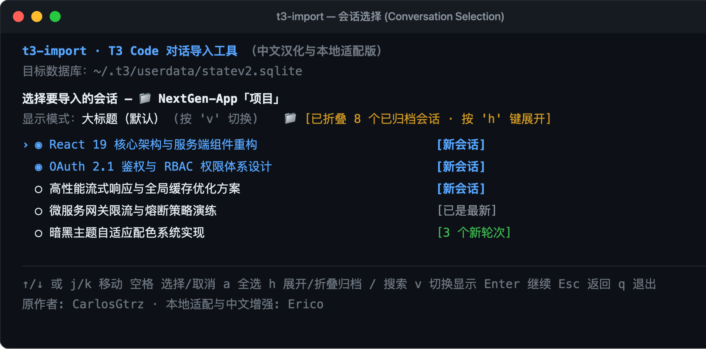
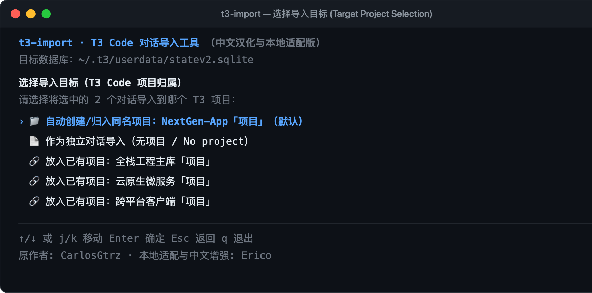

# t3-import

**Codex 与 Claude Code 对话历史导入 T3 Code 本地专业工具**  
*A professional local CLI/TUI to import, synchronize, and migrate Codex & Claude Code conversation histories into [T3 Code](https://github.com/pingdotgg/t3code).*

---

[简体中文](#简体中文) | [English](#english)

---

<a id="简体中文"></a>
## 简体中文

### 💡 核心特性

- **📁 项目文件夹与会话大标题深度适配**：
  - 自动读取 Codex 数据库与全局配置，精准还原用户自定义的会话大标题（如 `React 19 核心架构重构`）与项目文件夹（如 `📁 NextGen-App「项目」`），告别截断首句。
- **🎯 自由选择导入目标（拒绝机器盲目猜测）**：
  - **自动同名项目**：默认自动创建或归入同名 T3 项目，整洁规整。
  - **独立对话（无项目）**：将选中的对话直接作为独立会话导入左侧列表。
  - **放入已有项目**：动态读取当前 T3 现存活跃项目列表，一键精准归类。
- **📦 已归档会话智能折叠**：
  - 列表默认折叠已归档历史会话，按 `h` 键可随时展开/收起；全选快捷键 `a` 仅对可见项生效。
- **🧹 Codex 私有标签与模板自动净化**：
  - 自动剥离 `<oai-mem-citation>`、`<external_codex_apps_open_page>` 等非正文工具与内部记忆标签，并净化桌面版 Codex 注入的模板前缀（如 `# Files mentioned by the user:...## My request:`），还原真实干净的用户提示词与助手回复。
- **🛠️ 失效工作区与会话修复保护**：
  - 自动识别并清理失效的 Codex 沙盒临时工作区死路径，回退绑定至宿主项目根目录或合法环境，杜绝 T3 Code `This thread's workspace folder no longer exists` 导致的打不开与崩溃。
- **⚡ 超大对话流式引擎**：
  - 采用流式 SHA-256 指纹计算与分批处理，安全支持 >500MB+ 巨型对话，无内存溢出风险。
- **🔄 全生命周期管理**：
  - 支持初次导入（`import`）、增量续聊追加（`sync`）、旧任务整聊无损替换（`replace`）以及一键修复旧会话（`repair`）。
- **🛡️ 严格的数据安全防线**：
  - 仅在 T3 关闭状态下执行；每次操作前自动创建 SQLite 校验快照备份，安全重置 IndexedDB 缓存。

---

### 🖥️ 界面预览

#### 1. 会话选择界面（支持大标题、项目文件夹与折叠归档）


#### 2. 导入目标选择（支持自动项目、无项目独立对话、归入已有项目）


---

### 🚀 快速开始

#### 安装与启动

```bash
# 全局安装 (从 npm 或本地源码)
npm install --global t3-import

# 或直接克隆源码本地运行
git clone https://github.com/EricoEC/t3-import.git
cd t3-import
npm install && npm run build
npm install -g .

# 启动交互式终端界面（推荐）
t3-import
```

#### TUI 常用快捷键

| 按键 | 说明 |
| :--- | :--- |
| `↑` / `↓` 或 `j` / `k` | 上下移动光标 |
| `Space` (空格) | 选中 / 取消选中当前会话 |
| `a` | 全选 / 取消全选当前可见会话 |
| `h` | 展开 / 折叠已归档会话 |
| `v` | 切换显示模式（大标题 / 详细时间 / 物理路径） |
| `/` | 开启关键词即时搜索过滤 |
| `Enter` | 确认进入下一步 |
| `Esc` | 返回上一步 |
| `q` | 退出程序 |

---

### ⌨️ CLI 命令行模式

除交互式 TUI 外，所有操作均可通过 CLI 非交互式执行：

```bash
# 查看帮助
t3-import --help
t3-import import --help

# 导入指定项目下的指定会话
t3-import import --source codex --project "NextGen-App" --thread <thread-id> --yes --non-interactive

# 导入为独立对话（无项目 / No project）
t3-import import --source codex --project "NextGen-App" --all --no-project --yes --non-interactive

# 导入到指定的已有 T3 项目（支持项目名称或 UUID）
t3-import import --source codex --project "NextGen-App" --all --target-project "全栈工程主库「项目」" --yes --non-interactive

# 同步已导入会话的新增轮次
t3-import sync --source codex --workspace /path/to/project --all --yes --non-interactive

# 使用最新源记录无损替换旧任务
t3-import replace --source codex --workspace /path/to/project --thread <thread-id> --yes --non-interactive

# 运行只读环境诊断
t3-import doctor

# 修复旧版导入的会话（侧边栏消失 / 正文为空）
t3-import repair --yes

# 独立备份并重置 T3 UI 缓存（仅界面状态，不涉及聊天记录）
t3-import cache reset --yes
```

---

### ⚙️ 架构与数据安全

- **离线安全**：工具纯本地离线运行，仅在 T3 Code 关闭时操作本地 SQLite 数据库。
- **事件驱动写入**：严格遵循 T3 Code 事件溯源机制，仅追加 `orchestration_events` 标准事件流与会话运行时绑定，不直接篡改投影表，在 T3 启动时由官方引擎安全重建投影。
- **架构兼容**：全面适配 T3 Code V2 数据库架构（`~/.t3/userdata/statev2.sqlite`）与历史迁移。

---

<a id="english"></a>
## English

### 💡 Key Features

- **📁 Project Folders & Exact Titles**:
  - Automatically loads Codex sqlite metadata and configuration to restore custom conversation titles (e.g. `React 19 Server Components Architecture`) and user-defined project folders (`📁 NextGen-App`), avoiding truncated opening prompts.
- **🎯 Flexible Target Project Routing**:
  - **Auto Project (Default)**: Automatically creates or links to the matching project folder.
  - **Independent Conversations (No project)**: Imports threads directly into T3's general chat sidebar without creating project containers.
  - **Assign to Existing Project**: Dynamically lists active T3 projects to place conversations into existing workspaces without machine guesswork.
- **📦 Collapsible Archived Threads**:
  - Archived conversations are collapsed by default to keep the workspace clean; toggle with `h`. Bulk select (`a`) operates only on visible rows.
- **⚡ Large Conversation Streaming Engine**:
  - Re-architected with streaming SHA-256 checksums to safely process >500MB+ JSONL files without Node.js V8 memory exhaustion.
- **🔄 Full Lifecycle Support**:
  - Full support for initial import (`import`), appending settled turns (`sync`), and complete canonical task replacement (`replace`).
- **🛡️ Rock-Solid Data Safety**:
  - Enforces closed-T3 safety; creates verified timestamped SQLite backups before writing, with safe IndexedDB cache reset.

---

### 🖥️ Screenshots

#### 1. Conversation Selection (Title display, project folders, collapsed archives)


#### 2. Target Project Selection (Auto project, No project, or existing projects)


---

### 🚀 Quick Start

#### Installation & Launch

```bash
# Global install (from npm or local build)
npm install --global t3-import

# Or clone and run locally
git clone https://github.com/EricoEC/t3-import.git
cd t3-import
npm install && npm run build
npm install -g .

# Launch interactive TUI (Recommended)
t3-import
```

#### TUI Keyboard Shortcuts

| Key | Action |
| :--- | :--- |
| `↑` / `↓` or `j` / `k` | Navigate items |
| `Space` | Select / deselect conversation |
| `a` | Select / deselect all visible conversations |
| `h` | Toggle archived conversations (expand / collapse) |
| `v` | Switch display mode (Title / Timestamp / Path) |
| `/` | Search filter |
| `Enter` | Confirm and continue |
| `Esc` | Go back |
| `q` | Quit |

---

### ⌨️ CLI Usage

All capabilities can also run headlessly:

```bash
# Import a specific thread by project name
t3-import import --source codex --project "NextGen-App" --thread <thread-id> --yes --non-interactive

# Import as independent conversations (No project)
t3-import import --source codex --project "NextGen-App" --all --no-project --yes --non-interactive

# Import into an existing T3 project (by title or UUID)
t3-import import --source codex --project "NextGen-App" --all --target-project "Core Engineering Library" --yes --non-interactive

# Synchronize newly settled turns for previously imported conversations
t3-import sync --source codex --workspace /path/to/project --all --yes --non-interactive

# Replace an existing task with the complete provider transcript
t3-import replace --source codex --workspace /path/to/project --thread <thread-id> --yes --non-interactive

# Non-destructive diagnostics
t3-import doctor

# Repair conversations imported by older versions
t3-import repair --yes

# Reset IndexedDB cache safely (UI state only, never chat history)
t3-import cache reset --yes
```

---

## 贡献与鸣谢 / Contributions & Acknowledgements

- **开发者 / Developer**：[Erico](https://github.com/EricoEC)
- **核心开发与功能实现**：
  - 深度适配 Codex 项目文件夹与会话大标题精准解析映射
  - 自由选择导入目标（自动创建同名项目 / 无项目独立对话 / 归入已有活跃项目）
  - 超大对话流式指纹计算与批处理引擎（安全支持 >500MB 对话）
  - Codex 私有记忆与工具标签（`<oai-mem-citation>` / `<external_codex_apps_open_page>`）及桌面模板前缀自动净化
  - 失效工作区死路径检测与宿主项目根路径安全回退保护
  - 完整双语国际化支持与 T3 0.1.6 投影层兼容
- **致谢 / Acknowledgements**：
  - 本工具底层基础结构与初始原型参考自 [CarlosGtrz/t3-import](https://github.com/CarlosGtrz/t3-import) 的开源工作，特此鸣谢。
  - *Special thanks to [CarlosGtrz/t3-import](https://github.com/CarlosGtrz/t3-import) for the initial prototype and architecture reference.*
